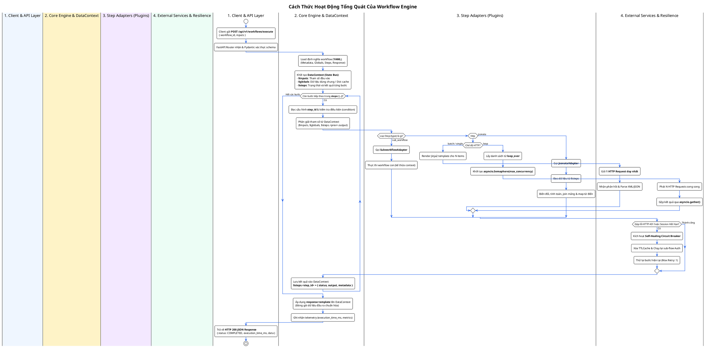
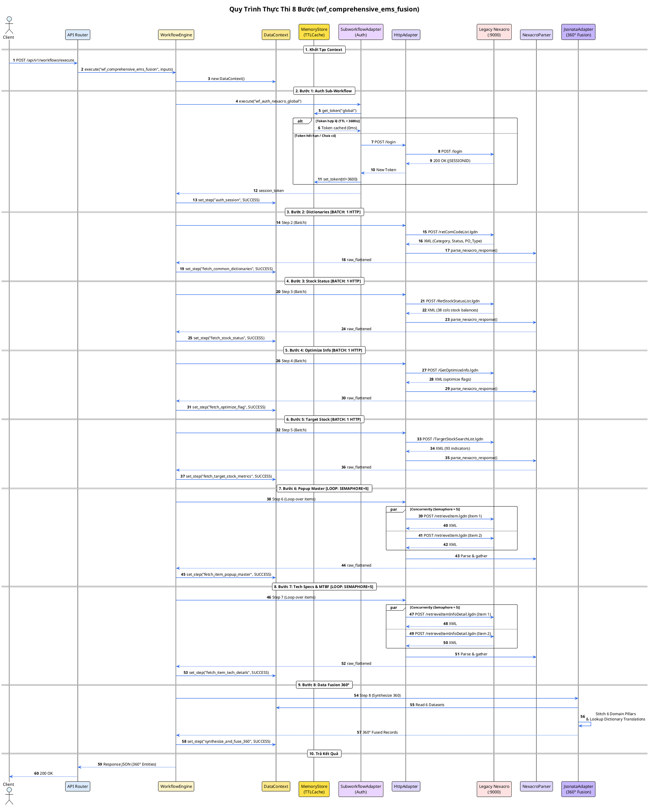
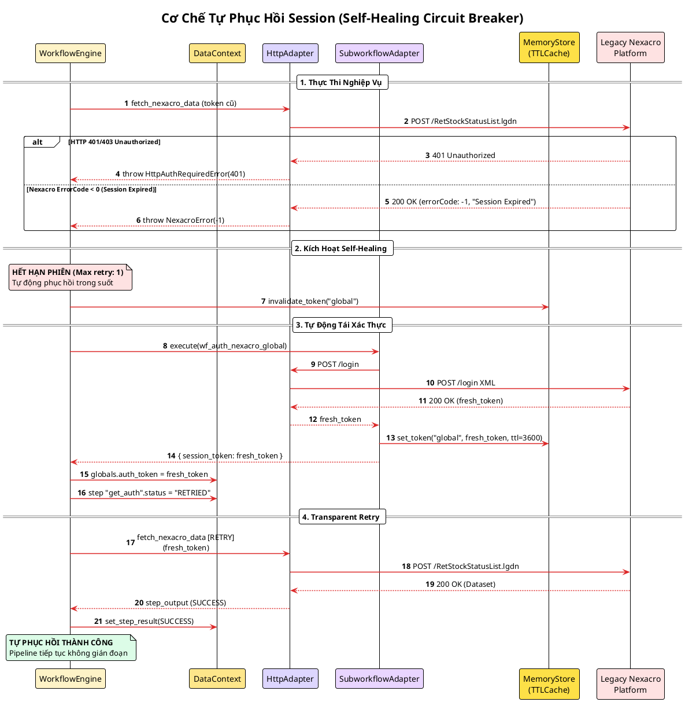
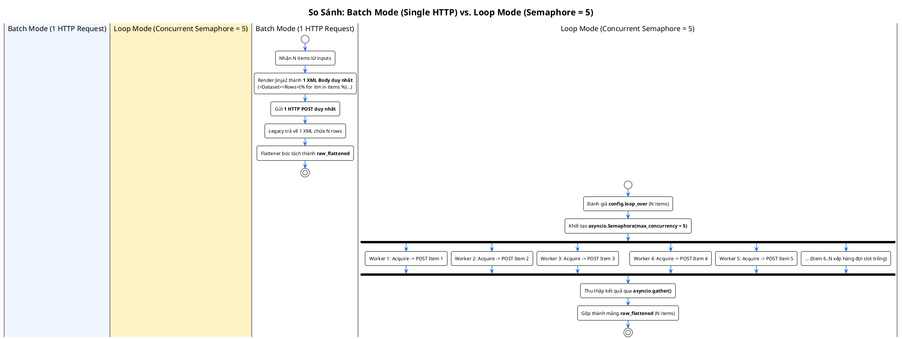
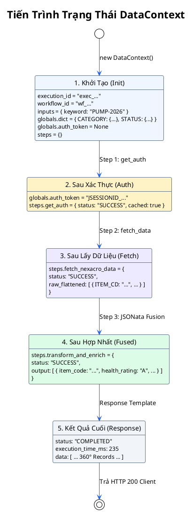
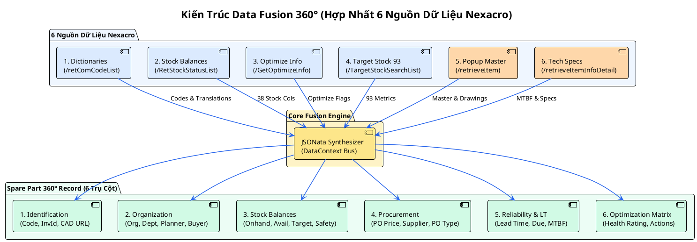

# TÀI LIỆU SƠ ĐỒ THIẾT KẾ & VẬN HÀNH WORKFLOW ENGINE
## (PlantUML Architecture, Concurrency & 360° Data Fusion Diagrams)

Tài liệu này tổng hợp **7 sơ đồ PlantUML** (đã xuất ra ảnh PNG chất lượng cao) mô tả toàn bộ cơ chế vận hành tổng quát của Workflow Engine, kiến trúc phân tầng, cơ chế điều phối tuần tự 8 bước (Sequential Orchestration), kỹ thuật phân biệt **Batch Mode (Single HTTP)** vs **Loop Mode (Bounded Concurrency Semaphore)**, cơ chế tự phục hồi (**Self-Healing Circuit Breaker**) và kiến trúc **Data Fusion 360°** hợp nhất 6 API Nexacro sản xuất (`t1.txt`).

> **Vị trí ảnh xuất ra:**
> - Linux/WSL: `/home/longp/projects/company/omni-ems/workflow-engine/docs/diagrams/*.png`
> - Windows: `\\wsl.localhost\Ubuntu\home\longp\projects\company\omni-ems\workflow-engine\docs\diagrams\`

---

## 0. Sơ Đồ Cách Thức Hoạt Động Tổng Quát Của Workflow Engine (Generic Lifecycle)

- File nguồn: [`docs/diagrams/00_general_workflow_operating_flow.puml`](file:///home/longp/projects/company/omni-ems/workflow-engine/docs/diagrams/00_general_workflow_operating_flow.puml)
- Ảnh xuất ra: [`docs/diagrams/General_Workflow_Operating_Flow.png`](file:///home/longp/projects/company/omni-ems/workflow-engine/docs/diagrams/General_Workflow_Operating_Flow.png)

---

## 1. Sơ Đồ Kiến Trúc Phân Tầng & Thành Phần (Architecture & Components)

- File nguồn: [`docs/diagrams/01_architecture_component.puml`](file:///home/longp/projects/company/omni-ems/workflow-engine/docs/diagrams/01_architecture_component.puml)
- Ảnh xuất ra: [`docs/diagrams/Architecture_Component_Diagram.png`](file:///home/longp/projects/company/omni-ems/workflow-engine/docs/diagrams/Architecture_Component_Diagram.png)

```plantuml
@startuml Architecture_Component_Diagram
!theme plain
skinparam backgroundColor #FFFFFF
skinparam roundcorner 8
skinparam shadowing false
skinparam componentStyle uml2
skinparam ArrowColor #2563EB
skinparam ArrowThickness 1.5

title Kiến Trúc Tổng Thể & Phân Tầng Workflow Engine (EMS 360 & 6 Legacy APIs)

actor "Primary Business App\n/ REST Client" as Client #E0F2FE

package "FastAPI Workflow Engine Core (Port 8000)" #F8FAFC {

    package "API & Routing Layer" #EFF6FF {
        component "app.main\n(FastAPI Router)" as APIRouter #DBEAFE
        component "Pydantic Schemas\n(ExecuteRequest / Response)" as Schemas #DBEAFE
    }

    package "Core Engine Layer (Domain-Agnostic)" #FEF3C7 {
        component "WorkflowEngine\n(Pipeline Orchestrator)" as Engine #FDE68A
        component "DataContext\n(In-Memory State Bus)" as DataCtx #FDE68A
        component "MemoryStore\n(cachetools TTLCache 3600s)" as MemStore #FDE68A
    }

    package "Adapters Layer" #F3E8FF {
        component "SubworkflowAdapter\n(Session Auth & Routing)" as SubWfAdapter #E9D5FF
        component "HttpAdapter\n(Dual Mode HTTP Dispatcher)" as HttpAdapter #E9D5FF
        component "NexacroParser\n(XML & Dataset Flattener)" as Parser #E9D5FF
        component "JsonataAdapter\n(360° Data Fusion Engine)" as Jsonata #E9D5FF
    }

    package "Template & Definition Store" #ECFDF5 {
        folder "app/workflows/\n(*.yaml Definitions)" as WorkflowsDir #D1FAE5
        folder "app/templates/\n(*.xml.j2 Jinja2 Templates)" as TemplatesDir #D1FAE5
    }
}

cloud "Legacy Nexacro EMS Platform (:9000)" as LegacyEMS #FEE2E2 {
    package "Batch Endpoints (Single HTTP for N items)" #FECACA {
        interface "1. POST /retComCodeList.lgdn\n(Common Code Dictionaries)" as API_Codes #FCA5A5
        interface "2. POST /RetStockStatusList.lgdn\n(Stock Balances - 38 Columns)" as API_Stock #FCA5A5
        interface "3. POST /GetOptimizeInfo.lgdn\n(Target Stock Optimization Flags)" as API_Opt #FCA5A5
        interface "4. POST /TargetStockSearchList.lgdn\n(Target Stock - 93 Indicators)" as API_Target #FCA5A5
    }

    package "Loop Endpoints (Concurrent Semaphore = 5)" #FED7AA {
        interface "5. POST /retrieveItem.lgdn\n(Item Master & FDM CAD URL)" as API_Popup #FDBA74
        interface "6. POST /retrieveItemInfoDetail.lgdn\n(Tech Specs & MTBF Reliability)" as API_Tech #FDBA74
    }

    database "Legacy Database\n(SQLite / Oracle EMS)" as DB #FECACA
}

' Flow Connections
Client --> APIRouter : 1. POST /api/v1/workflows/execute\n{workflow_id: "wf_comprehensive_ems_fusion", inputs: {...}}
APIRouter --> Schemas : Validate Request
APIRouter --> Engine : Dispatch Execution

Engine ..> WorkflowsDir : Ingest YAML Definition
Engine --> DataCtx : Initialize Context\n($inputs, $globals, $steps)
Engine --> MemStore : Check Session Token

' Step 1: Sub-workflow Auth
Engine --> SubWfAdapter : Step 1: execute_sub_workflow\n(wf_auth_nexacro_global)
SubWfAdapter --> MemStore : Check TTLCache (0ms network hit)
SubWfAdapter ..> Engine : Auto-login & Refresh if Expired

' Step 2-5: Batch Mode Execution
Engine --> HttpAdapter : Steps 2, 3, 4, 5: BATCH MODE
HttpAdapter ..> TemplatesDir : Render Jinja2 Batch Template\n<Dataset><Rows>{% for item in items %}...</Rows></Dataset>
HttpAdapter --> API_Codes : 1 HTTP POST (Batch)
HttpAdapter --> API_Stock : 1 HTTP POST (Batch 38 cols)
HttpAdapter --> API_Opt : 1 HTTP POST (Batch)
HttpAdapter --> API_Target : 1 HTTP POST (Batch 93 metrics)

' Step 6-7: Concurrent Loop Mode Execution
Engine --> HttpAdapter : Steps 6, 7: CONCURRENT LOOP MODE
note right of HttpAdapter
  **Bounded Concurrency Pattern:**
  - Resolve items array via config.loop_over
  - asyncio.Semaphore(max_concurrency = 5)
  - N parallel workers render individual XML
  - asyncio.gather(*tasks) merges results
end note
HttpAdapter --> API_Popup : N Parallel POSTs (Semaphore=5)
HttpAdapter --> API_Tech : N Parallel POSTs (Semaphore=5)

API_Codes --> DB
API_Stock --> DB
API_Opt --> DB
API_Target --> DB
API_Popup --> DB
API_Tech --> DB

' Response Parsing
LegacyEMS --> HttpAdapter : XML Response Payloads
HttpAdapter --> Parser : Parse Nexacro XML
Parser --> DataCtx : Extract metadata & raw_flattened arrays

' Step 8: 360 Data Fusion
Engine --> Jsonata : Step 8: transform_jsonata\n(synthesize_and_fuse_360)
Jsonata --> DataCtx : Read all 6 raw_flattened datasets
Jsonata --> Jsonata : Merge 6 pillars into Spare Part 360 Master Record
Jsonata --> DataCtx : Write normalized 360° entities

' Output Response
DataCtx --> Engine : Resolve Response Block
Engine --> APIRouter : Normalized JSON Payload
APIRouter --> Client : 2. HTTP 200 OK\n{status: COMPLETED, data: [Spare Part 360 Objects]}

@enduml
```

---

## 2. Sơ Đồ Tuần Tự Luồng Thực Thi 8 Bước (Sequential Pipeline Sequence)

- File nguồn: [`docs/diagrams/02_workflow_execution_sequence.puml`](file:///home/longp/projects/company/omni-ems/workflow-engine/docs/diagrams/02_workflow_execution_sequence.puml)
- Ảnh xuất ra: [`docs/diagrams/Workflow_Execution_Sequence.png`](file:///home/longp/projects/company/omni-ems/workflow-engine/docs/diagrams/Workflow_Execution_Sequence.png)

---

## 3. Sơ Đồ Cơ Chế Tự Phục Hồi Session (Self-Healing Circuit Breaker)

- File nguồn: [`docs/diagrams/03_self_healing_circuit_breaker.puml`](file:///home/longp/projects/company/omni-ems/workflow-engine/docs/diagrams/03_self_healing_circuit_breaker.puml)
- Ảnh xuất ra: [`docs/diagrams/Self_Healing_Circuit_Breaker.png`](file:///home/longp/projects/company/omni-ems/workflow-engine/docs/diagrams/Self_Healing_Circuit_Breaker.png)

---

## 4. Sơ Đồ So Sánh: Batch Mode vs. Loop Mode (Concurrency)

- File nguồn: [`docs/diagrams/04_single_vs_loop_concurrency.puml`](file:///home/longp/projects/company/omni-ems/workflow-engine/docs/diagrams/04_single_vs_loop_concurrency.puml)
- Ảnh xuất ra: [`docs/diagrams/Single_vs_Loop_Concurrency.png`](file:///home/longp/projects/company/omni-ems/workflow-engine/docs/diagrams/Single_vs_Loop_Concurrency.png)

---

## 5. Sơ Đồ Tiến Trình Trạng Thái DataContext

- File nguồn: [`docs/diagrams/05_data_context_state_evolution.puml`](file:///home/longp/projects/company/omni-ems/workflow-engine/docs/diagrams/05_data_context_state_evolution.puml)
- Ảnh xuất ra: [`docs/diagrams/DataContext_State_Evolution.png`](file:///home/longp/projects/company/omni-ems/workflow-engine/docs/diagrams/DataContext_State_Evolution.png)

---

## 6. Sơ Đồ Kiến Trúc Data Fusion 360° (Comprehensive Entity Stitching)

- File nguồn: [`docs/diagrams/06_comprehensive_data_fusion_360.puml`](file:///home/longp/projects/company/omni-ems/workflow-engine/docs/diagrams/06_comprehensive_data_fusion_360.puml)
- Ảnh xuất ra: [`docs/diagrams/Comprehensive_Data_Fusion_360.png`](file:///home/longp/projects/company/omni-ems/workflow-engine/docs/diagrams/Comprehensive_Data_Fusion_360.png)

