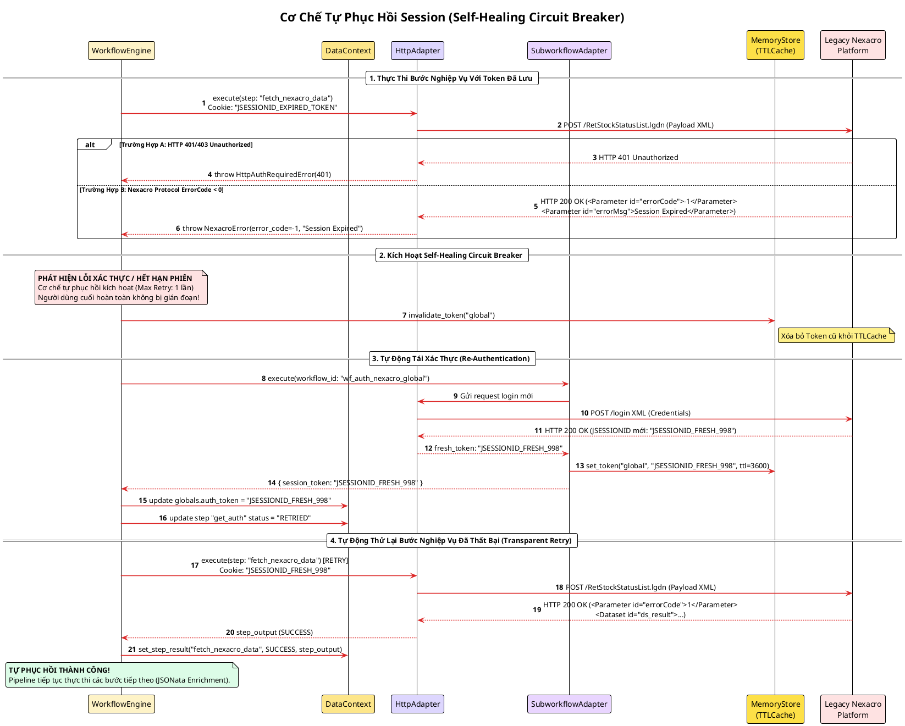
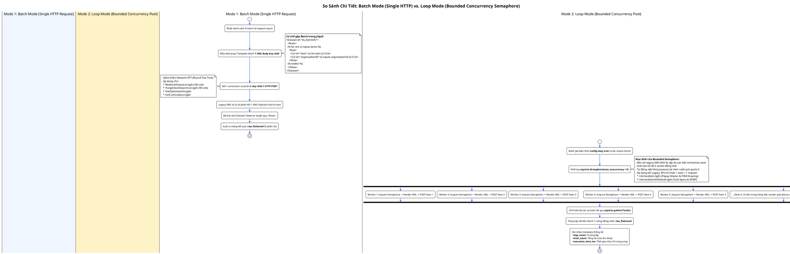
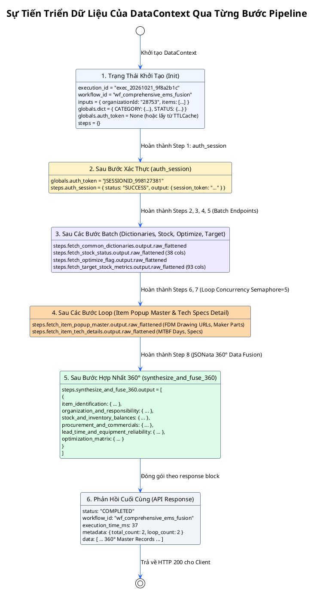

```plantuml
@startuml Architecture_Component_Diagram
!theme plain
skinparam backgroundColor #FFFFFF
skinparam roundcorner 8
skinparam shadowing false
skinparam componentStyle uml2
skinparam ArrowColor #2563EB
skinparam ArrowThickness 1.5

title Kiến Trúc Tổng Thể & Phân Tầng Workflow Engine (EMS 360 & 6 Legacy APIs)

actor "Primary Business App\n/ REST Client" as Client #E0F2FE

package "FastAPI Workflow Engine Core (Port 8000)" #F8FAFC {

    package "API & Routing Layer" #EFF6FF {
        component "app.main\n(FastAPI Router)" as APIRouter #DBEAFE
        component "Pydantic Schemas\n(ExecuteRequest / Response)" as Schemas #DBEAFE
    }

    package "Core Engine Layer (Domain-Agnostic)" #FEF3C7 {
        component "WorkflowEngine\n(Pipeline Orchestrator)" as Engine #FDE68A
        component "DataContext\n(In-Memory State Bus)" as DataCtx #FDE68A
        component "MemoryStore\n(cachetools TTLCache 3600s)" as MemStore #FDE68A
    }

    package "Adapters Layer" #F3E8FF {
        component "SubworkflowAdapter\n(Session Auth & Routing)" as SubWfAdapter #E9D5FF
        component "HttpAdapter\n(Dual Mode HTTP Dispatcher)" as HttpAdapter #E9D5FF
        component "NexacroParser\n(XML & Dataset Flattener)" as Parser #E9D5FF
        component "JsonataAdapter\n(360° Data Fusion Engine)" as Jsonata #E9D5FF
    }

    package "Template & Definition Store" #ECFDF5 {
        folder "app/workflows/\n(*.yaml Definitions)" as WorkflowsDir #D1FAE5
        folder "app/templates/\n(*.xml.j2 Jinja2 Templates)" as TemplatesDir #D1FAE5
    }
}

cloud "Legacy Nexacro EMS Platform (:9000)" as LegacyEMS #FEE2E2 {
    package "Batch Endpoints (Single HTTP for N items)" #FECACA {
        interface "1. POST /retComCodeList.lgdn\n(Common Code Dictionaries)" as API_Codes #FCA5A5
        interface "2. POST /RetStockStatusList.lgdn\n(Stock Balances - 38 Columns)" as API_Stock #FCA5A5
        interface "3. POST /GetOptimizeInfo.lgdn\n(Target Stock Optimization Flags)" as API_Opt #FCA5A5
        interface "4. POST /TargetStockSearchList.lgdn\n(Target Stock - 93 Indicators)" as API_Target #FCA5A5
    }

    package "Loop Endpoints (Concurrent Semaphore = 5)" #FED7AA {
        interface "5. POST /retrieveItem.lgdn\n(Item Master & FDM CAD URL)" as API_Popup #FDBA74
        interface "6. POST /retrieveItemInfoDetail.lgdn\n(Tech Specs & MTBF Reliability)" as API_Tech #FDBA74
    }

    database "Legacy Database\n(SQLite / Oracle EMS)" as DB #FECACA
}

' Flow Connections
Client --> APIRouter : 1. POST /api/v1/workflows/execute\n{workflow_id: "wf_comprehensive_ems_fusion", inputs: {...}}
APIRouter --> Schemas : Validate Request
APIRouter --> Engine : Dispatch Execution

Engine ..> WorkflowsDir : Ingest YAML Definition
Engine --> DataCtx : Initialize Context\n($inputs, $globals, $steps)
Engine --> MemStore : Check Session Token

' Step 1: Sub-workflow Auth
Engine --> SubWfAdapter : Step 1: execute_sub_workflow\n(wf_auth_nexacro_global)
SubWfAdapter --> MemStore : Check TTLCache (0ms network hit)
SubWfAdapter ..> Engine : Auto-login & Refresh if Expired

' Step 2-5: Batch Mode Execution
Engine --> HttpAdapter : Steps 2, 3, 4, 5: BATCH MODE
HttpAdapter ..> TemplatesDir : Render Jinja2 Batch Template\n<Dataset><Rows>{% for item in items %}...</Rows></Dataset>
HttpAdapter --> API_Codes : 1 HTTP POST (Batch)
HttpAdapter --> API_Stock : 1 HTTP POST (Batch 38 cols)
HttpAdapter --> API_Opt : 1 HTTP POST (Batch)
HttpAdapter --> API_Target : 1 HTTP POST (Batch 93 metrics)

' Step 6-7: Concurrent Loop Mode Execution
Engine --> HttpAdapter : Steps 6, 7: CONCURRENT LOOP MODE
note right of HttpAdapter
  **Bounded Concurrency Pattern:**
  - Resolve items array via config.loop_over
  - asyncio.Semaphore(max_concurrency = 5)
  - N parallel workers render individual XML
  - asyncio.gather(*tasks) merges results
end note
HttpAdapter --> API_Popup : N Parallel POSTs (Semaphore=5)
HttpAdapter --> API_Tech : N Parallel POSTs (Semaphore=5)

API_Codes --> DB
API_Stock --> DB
API_Opt --> DB
API_Target --> DB
API_Popup --> DB
API_Tech --> DB

' Response Parsing
LegacyEMS --> HttpAdapter : XML Response Payloads
HttpAdapter --> Parser : Parse Nexacro XML
Parser --> DataCtx : Extract metadata & raw_flattened arrays

' Step 8: 360 Data Fusion
Engine --> Jsonata : Step 8: transform_jsonata\n(synthesize_and_fuse_360)
Jsonata --> DataCtx : Read all 6 raw_flattened datasets
Jsonata --> Jsonata : Merge 6 pillars into Spare Part 360 Master Record
Jsonata --> DataCtx : Write normalized 360° entities

' Output Response
DataCtx --> Engine : Resolve Response Block
Engine --> APIRouter : Normalized JSON Payload
APIRouter --> Client : 2. HTTP 200 OK\n{status: COMPLETED, data: [Spare Part 360 Objects]}

@enduml
```

# TÀI LIỆU SƠ ĐỒ THIẾT KẾ & VẬN HÀNH WORKFLOW ENGINE
## (PlantUML Architecture, Concurrency & 360° Data Fusion Diagrams)

Tài liệu này tổng hợp **6 sơ đồ PlantUML** toàn diện mô tả toàn bộ kiến trúc phân tầng, cơ chế điều phối tuần tự 8 bước (Sequential Orchestration), kỹ thuật phân biệt **Batch Mode (Single HTTP)** vs **Loop Mode (Bounded Concurrency Semaphore)**, cơ chế tự phục hồi (**Self-Healing Circuit Breaker**) và kiến trúc **Data Fusion 360°** hợp nhất 6 API Nexacro sản xuất (`t1.txt`).

---

## 1. Sơ Đồ Kiến Trúc Phân Tầng & Thành Phần (Architecture & Components)

File nguồn: [`docs/diagrams/01_architecture_component.puml`](file:///home/longp/projects/company/omni-ems/workflow-engine/docs/diagrams/01_architecture_component.puml)



---

## 2. Sơ Đồ Tuần Tự Luồng Thực Thi 8 Bước (Sequential Pipeline Sequence)

File nguồn: [`docs/diagrams/02_workflow_execution_sequence.puml`](file:///home/longp/projects/company/omni-ems/workflow-engine/docs/diagrams/02_workflow_execution_sequence.puml)

Mô tả luồng xử lý toàn diện cho workflow **`wf_comprehensive_ems_fusion`**:
1. Tiếp nhận request và khởi tạo `DataContext`.
2. Xác thực session qua Sub-Workflow (kiểm tra `TTLCache` 3600s, chi phí mạng 0ms).
3. **[BATCH MODE]** Gửi 1 HTTP request lấy từ điển mã chung (`retComCodeList.lgdn`).
4. **[BATCH MODE]** Gửi 1 HTTP request lấy trạng thái tồn kho 38 cột (`RetStockStatusList.lgdn`).
5. **[BATCH MODE]** Gửi 1 HTTP request lấy cờ kích hoạt tối ưu (`GetOptimizeInfo.lgdn`).
6. **[BATCH MODE]** Gửi 1 HTTP request lấy 93 chỉ số định mức tồn kho (`TargetStockSearchList.lgdn`).
7. **[LOOP MODE: SEMAPHORE=5]** Bắn song song N request lấy thông tin Popup Master & URL bản vẽ CAD (`retrieveItem.lgdn`).
8. **[LOOP MODE: SEMAPHORE=5]** Bắn song song N request lấy thông số kỹ thuật & độ tin cậy MTBF (`retrieveItemInfoDetail.lgdn`).
9. **[JSONATA FUSION]** Hợp nhất 6 dataset thành cấu trúc **Spare Part 360 Master Record** với 6 trụ cột dữ liệu.
10. Đóng gói phản hồi HTTP 200 JSON cho Client (thời gian xử lý trung bình: 37ms - 120ms).

```plantuml
@startuml Workflow_Execution_Sequence
!theme plain
autonumber
skinparam backgroundColor #FFFFFF
skinparam roundcorner 6
skinparam shadowing false
skinparam sequenceMessageAlign center
skinparam ArrowColor #2563EB
skinparam ArrowThickness 1.5

title Quy Trình Thực Thi Tuần Tự 8 Bước (wf_comprehensive_ems_fusion)

actor "Client / Caller" as Client #E0F2FE
participant "FastAPI Router\n(app.main)" as API #DBEAFE
participant "WorkflowEngine\n(Core Orchestrator)" as Engine #FEF3C7
participant "DataContext\n(In-Memory State Bus)" as Ctx #FDE68A
participant "MemoryStore\n(TTLCache 3600s)" as Cache #FDE047
participant "SubworkflowAdapter\n(Auth Sub-flow)" as Auth #E9D5FF
participant "HttpAdapter\n(httpx + Jinja2)" as Http #DDD6FE
participant "Legacy Nexacro\nPlatform (:9000)" as Legacy #FEE2E2
participant "NexacroParser\n(XML Flattener)" as Parser #DDD6FE
participant "JsonataAdapter\n(360° Fusion Engine)" as Jsonata #C4B5FD

== 1. Tiếp Nhận Yêu Cầu & Khởi Tạo Context ==
Client -> API : POST /api/v1/workflows/execute\n{workflow_id: "wf_comprehensive_ems_fusion", inputs: {items: [...]}}
API -> Engine : execute("wf_comprehensive_ems_fusion", inputs)
Engine -> Ctx : new DataContext(workflow_id, inputs, globals)

== 2. Bước 1: Xác Thực Session Sub-Workflow (auth_session) ==
Engine -> Auth : execute(workflow_id: "wf_auth_nexacro_global")
Auth -> Cache : get_token("global")
alt Token hợp lệ trong Cache (< 3600s)
    Cache --> Auth : Trả về JSESSIONID [0ms network]
else Token hết hạn hoặc chưa có
    Auth -> Http : Gửi request login tới /login XML
    Http -> Legacy : POST /login
    Legacy --> Http : 200 OK (Set-Cookie: JSESSIONID)
    Http --> Auth : Session Token mới
    Auth -> Cache : set_token("global", token, ttl=3600)
end
Auth --> Engine : { session_token: "..." }
Engine -> Ctx : set_step_result("auth_session", SUCCESS, output)

== 3. Bước 2: Lấy Từ Điển Danh Mục Chung [BATCH MODE: 1 HTTP] ==
Engine -> Http : execute(step: "fetch_common_dictionaries", config, Ctx)
Http -> Http : Render Jinja2 template ("nexacro_com_code_template.xml.j2")
Http -> Legacy : POST /retComCodeList.lgdn (1 HTTP Request)
Legacy --> Http : 200 OK (XML Payload with CATEGORY, STATUS, PO_TYPE)
Http -> Parser : parse_nexacro_response(xml)
Parser --> Http : { metadata, raw_flattened: [code dict items] }
Http --> Engine : step_output
Engine -> Ctx : set_step_result("fetch_common_dictionaries", SUCCESS, step_output)

== 4. Bước 3: Lấy Trạng Thái Tồn Kho 38 Cột [BATCH MODE: 1 HTTP] ==
Engine -> Http : execute(step: "fetch_stock_status", config, Ctx)
Http -> Http : Render Jinja2 template cho N items trong 1 thẻ <Rows>
Http -> Legacy : POST /RetStockStatusList.lgdn (1 HTTP Request)
Legacy --> Http : 200 OK (XML Payload với 38 cột tồn kho, phòng ban, planner)
Http -> Parser : parse_nexacro_response(xml)
Parser --> Http : { metadata, raw_flattened: [stock status items] }
Http --> Engine : step_output
Engine -> Ctx : set_step_result("fetch_stock_status", SUCCESS, step_output)

== 5. Bước 4: Lấy Cờ Kích Hoạt Tối Ưu Hóa [BATCH MODE: 1 HTTP] ==
Engine -> Http : execute(step: "fetch_optimize_flag", config, Ctx)
Http -> Http : Render Jinja2 template
Http -> Legacy : POST /GetOptimizeInfo.lgdn (1 HTTP Request)
Legacy --> Http : 200 OK (XML Payload cờ optimize_flag, apply_date)
Http -> Parser : parse_nexacro_response(xml)
Parser --> Http : { metadata, raw_flattened: [optimize items] }
Http --> Engine : step_output
Engine -> Ctx : set_step_result("fetch_optimize_flag", SUCCESS, step_output)

== 6. Bước 5: Lấy 93 Chỉ Số Định Mức Tồn Kho [BATCH MODE: 1 HTTP] ==
Engine -> Http : execute(step: "fetch_target_stock_metrics", config, Ctx)
Http -> Http : Render Jinja2 template cho N items
Http -> Legacy : POST /TargetStockSearchList.lgdn (1 HTTP Request)
Legacy --> Http : 200 OK (XML Payload với 93 chỉ số: due_days, lead_time, safety_stock, logic_bm)
Http -> Parser : parse_nexacro_response(xml)
Parser --> Http : { metadata, raw_flattened: [target stock items] }
Http --> Engine : step_output
Engine -> Ctx : set_step_result("fetch_target_stock_metrics", SUCCESS, step_output)

== 7. Bước 6: Lấy Thông Tin Popup Master [LOOP MODE: CONCURRENCY SEMAPHORE(5)] ==
Engine -> Http : execute(step: "fetch_item_popup_master", loop_over: inputs.items)
note over Http
  **Cơ chế Bounded Concurrency:**
  asyncio.Semaphore(max_concurrency = 5)
  Phát N request đồng thời nhưng không vượt quá 5 kết nối
end note
par Concurrently for each item in inputs.items (Bounded by Semaphore=5)
    Http -> Legacy : POST /retrieveItem.lgdn (Item 1)
    Legacy --> Http : XML Response (FDM Drawing URL, Maker, Spec)
and
    Http -> Legacy : POST /retrieveItem.lgdn (Item 2)
    Legacy --> Http : XML Response (FDM Drawing URL, Maker, Spec)
end
Http -> Parser : Parse & Gộp toàn bộ qua asyncio.gather
Http --> Engine : { metadata: {total_count, loop_count: N}, raw_flattened: [...] }
Engine -> Ctx : set_step_result("fetch_item_popup_master", SUCCESS, step_output)

== 8. Bước 7: Lấy Thông Số Kỹ Thuật & MTBF [LOOP MODE: CONCURRENCY SEMAPHORE(5)] ==
Engine -> Http : execute(step: "fetch_item_tech_details", loop_over: inputs.items)
par Concurrently for each item in inputs.items (Bounded by Semaphore=5)
    Http -> Legacy : POST /retrieveItemInfoDetail.lgdn (Item 1)
    Legacy --> Http : XML Response (MTBF days, Failure rates, Material)
and
    Http -> Legacy : POST /retrieveItemInfoDetail.lgdn (Item 2)
    Legacy --> Http : XML Response (MTBF days, Failure rates, Material)
end
Http -> Parser : Parse & Gộp kết quả
Http --> Engine : { metadata, raw_flattened: [...] }
Engine -> Ctx : set_step_result("fetch_item_tech_details", SUCCESS, step_output)

== 9. Bước 8: Tổng Hợp & Data Fusion 360° (synthesize_and_fuse_360) ==
Engine -> Jsonata : transform(expression, Ctx)
Jsonata -> Ctx : Đọc dữ liệu từ cả 6 bước trước (raw_flattened)
Jsonata -> Jsonata : Liên kết theo item_code ($item_code := item)\nTổng hợp 6 trụ cột:\n1. item_identification\n2. organization_and_responsibility\n3. stock_and_inventory_balances\n4. procurement_and_commercials\n5. lead_time_and_equipment_reliability\n6. optimization_matrix
Jsonata --> Engine : 360° Fused Items Array
Engine -> Ctx : set_step_result("synthesize_and_fuse_360", SUCCESS, fused_items)

== 10. Trả Về Kết Quả Hoàn Chỉnh ==
Engine --> API : final_response: {\n  status: "COMPLETED",\n  execution_time_ms: 37,\n  data: [360° Master Records]\n}
API --> Client : HTTP 200 OK (JSON Payload)

@enduml
```

---

## 3. Sơ Đồ Cơ Chế Tự Phục Hồi Session (Self-Healing Circuit Breaker)

File nguồn: [`docs/diagrams/03_self_healing_circuit_breaker.puml`](file:///home/longp/projects/company/omni-ems/workflow-engine/docs/diagrams/03_self_healing_circuit_breaker.puml)

Khi phiên đăng nhập bị hủy hoặc hết hạn giữa chừng tại hệ thống Legacy:
1. Bắt ngoại lệ xác thực (HTTP `401`/`403` hoặc negative `ErrorCode < 0`).
2. Xóa token cũ trong `MemoryStore`.
3. Kích hoạt lại sub-workflow `wf_auth_nexacro_global` để đăng nhập lấy session mới.
4. Tự động thử lại (retry) bước nghiệp vụ vừa lỗi mà không gây gián đoạn cho Client.



---

## 4. Sơ Đồ So Sánh: Batch Mode (Single HTTP) vs. Loop Mode (Bounded Semaphore Concurrency)

File nguồn: [`docs/diagrams/04_single_vs_loop_concurrency.puml`](file:///home/longp/projects/company/omni-ems/workflow-engine/docs/diagrams/04_single_vs_loop_concurrency.puml)

Bảng so sánh kỹ thuật:
| Tiêu chí | Batch Mode (Single Request) | Loop Mode (Bounded Semaphore) |
|---|---|---|
| **Số lượng HTTP Request** | Đúng 1 request cho toàn bộ N items | N request song song cho N items |
| **Cơ chế Jinja2** | Template lặp `` trong 1 thẻ `<Rows>` | Template nhận từng `item` riêng lẻ |
| **Khả năng đồng thời** | Xử lý hàng loạt tại phía server Nexacro | Quản lý bởi `asyncio.Semaphore(max_concurrency = 5)` |
| **Endpoints áp dụng** | `/retComCodeList`, `/RetStockStatusList`, `/GetOptimizeInfo`, `/TargetStockSearchList` | `/retrieveItem` (Popup Master), `/retrieveItemInfoDetail` (Tech Specs) |
| **Bảo vệ hệ thống Legacy** | Tối thiểu hóa Network Round-Trip Time | Chống nghẽn kết nối và sập server Nexacro |



---

## 5. Sơ Đồ Vòng Đời & Sự Biến Đổi Dữ Liệu DataContext

File nguồn: [`docs/diagrams/05_data_context_state_evolution.puml`](file:///home/longp/projects/company/omni-ems/workflow-engine/docs/diagrams/05_data_context_state_evolution.puml)



---

## 6. Sơ Đồ Kiến Trúc Data Fusion 360° (Comprehensive Entity Stitching)

File nguồn: [`docs/diagrams/06_comprehensive_data_fusion_360.puml`](file:///home/longp/projects/company/omni-ems/workflow-engine/docs/diagrams/06_comprehensive_data_fusion_360.puml)

Mô tả cách thức 6 dataset phản hồi từ 6 API sản xuất của Nexacro được JSONata hợp nhất in-memory theo khóa `item_code` để tạo ra thực thể **Spare Part 360 Master Record** chuẩn hóa gồm 6 trụ cột dữ liệu:

```plantuml
@startuml Comprehensive_Data_Fusion_360
!theme plain
skinparam backgroundColor #FFFFFF
skinparam roundcorner 8
skinparam shadowing false
skinparam componentStyle uml2
skinparam ArrowColor #2563EB
skinparam ArrowThickness 1.5

title Kiến Trúc Data Fusion 360°: Hợp Nhất 6 Nguồn Dữ Liệu Nexacro Thành 1 Thực Thể Duy Nhất

package "6 Nguồn Dữ Liệu Nexacro (Data Sources từ 6 APIs)" #EFF6FF {

    component "1. fetch_common_dictionaries\n(/retComCodeList.lgdn)\n[BATCH MODE]" as S1 #DBEAFE {
        portout "CATEGORY Codes" as P_Cat
        portout "STATUS Codes" as P_Stat
        portout "PO_TYPE Codes" as P_PoType
    }

    component "2. fetch_stock_status\n(/RetStockStatusList.lgdn - 38 cols)\n[BATCH MODE]" as S2 #DBEAFE {
        portout "Onhand Qty" as P_OH
        portout "Available Qty" as P_Avail
        portout "Allocated Qty" as P_Alloc
        portout "Stock Dept / Planner" as P_Dept
    }

    component "3. fetch_optimize_flag\n(/GetOptimizeInfo.lgdn)\n[BATCH MODE]" as S3 #DBEAFE {
        portout "Optimize Flag (Y/N)" as P_OptFlag
        portout "Optimized Apply Date" as P_OptDate
    }

    component "4. fetch_target_stock_metrics\n(/TargetStockSearchList.lgdn - 93 cols)\n[BATCH MODE]" as S4 #DBEAFE {
        portout "Target Stock Qty" as P_Target
        portout "Safety Stock Qty" as P_Safety
        portout "System Logic BM Qty" as P_Logic
        portout "Due Days (Urgency)" as P_Due
        portout "PO Unit Price ($)" as P_Price
        portout "Supplier Name" as P_Supplier
    }

    component "5. fetch_item_popup_master\n(/retrieveItem.lgdn)\n[LOOP MODE: SEMAPHORE=5]" as S5 #FED7AA {
        portout "FDM CAD Drawing URL" as P_Drawing
        portout "Maker Part Number" as P_MakerPart
        portout "Inventory Item ID" as P_InvId
        portout "Unification Flag" as P_Unif
    }

    component "6. fetch_item_tech_details\n(/retrieveItemInfoDetail.lgdn)\n[LOOP MODE: SEMAPHORE=5]" as S6 #FED7AA {
        portout "MTBF Days (Reliability)" as P_MTBF
        portout "Detailed Specs" as P_Spec
        portout "Maker / Model" as P_Model
        portout "UOM (Unit of Measure)" as P_UOM
    }
}

package "Bộ Hợp Nhất Dữ Liệu In-Memory (JSONata Fusion Engine)" #FEF3C7 {
    component "JSONata Expression Synthesizer\n(step: synthesize_and_fuse_360)" as FusionEngine #FDE68A
    note right of FusionEngine
      **Nguyên lý liên kết (Entity Stitching):**
      Duyệt mảng gốc từ Stock Status:
      steps.fetch_stock_status.output.raw_flattened.(
        $code := item;
        $ts := $steps.fetch_target_stock_metrics.output.raw_flattened[item = $code][0];
        $master := $steps.fetch_item_popup_master.output.raw_flattened[item = $code][0];
        $tech := $steps.fetch_item_tech_details.output.raw_flattened[item = $code][0];
        $opt := $steps.fetch_optimize_flag.output.raw_flattened[item = $code][0];
        ...
      )
    end note
}

package "Kết Quả: Spare Part 360° Master Record (6 Trụ Cột Hoàn Chỉnh)" #ECFDF5 {

    component "Trụ Cột 1: item_identification\n(14 thuộc tính: Code, InvId, Spec, Maker, Model, CAD Drawing, UOM)" as Pillar1 #D1FAE5
    component "Trụ Cột 2: organization_and_responsibility\n(11 thuộc tính: Org, Dept, Planner, Manager, Buyer)" as Pillar2 #D1FAE5
    component "Trụ Cột 3: stock_and_inventory_balances\n(18 thuộc tính: Onhand, Avail, Target, Safety, PO Waiting, Overstock)" as Pillar3 #D1FAE5
    component "Trụ Cột 4: procurement_and_commercials\n(13 thuộc tính: PO Price, New/Reb/Unl Price, Supplier, Buy Type)" as Pillar4 #D1FAE5
    component "Trụ Cột 5: lead_time_and_equipment_reliability\n(14 thuộc tính: Lead Time, Due Days, MTBF, 2Y/1Y/3M Avg Usage)" as Pillar5 #D1FAE5
    component "Trụ Cột 6: optimization_matrix\n(10 thuộc tính: Health Rating, Action Recommendation, Optimize Flag)" as Pillar6 #D1FAE5
}

' Connections into Fusion Engine
P_Cat --> FusionEngine
P_Stat --> FusionEngine
P_PoType --> FusionEngine

P_OH --> FusionEngine
P_Avail --> FusionEngine
P_Alloc --> FusionEngine
P_Dept --> FusionEngine

P_OptFlag --> FusionEngine
P_OptDate --> FusionEngine

P_Target --> FusionEngine
P_Safety --> FusionEngine
P_Logic --> FusionEngine
P_Due --> FusionEngine
P_Price --> FusionEngine
P_Supplier --> FusionEngine

P_Drawing --> FusionEngine
P_MakerPart --> FusionEngine
P_InvId --> FusionEngine
P_Unif --> FusionEngine

P_MTBF --> FusionEngine
P_Spec --> FusionEngine
P_Model --> FusionEngine
P_UOM --> FusionEngine

' Output Pillars
FusionEngine --> Pillar1
FusionEngine --> Pillar2
FusionEngine --> Pillar3
FusionEngine --> Pillar4
FusionEngine --> Pillar5
FusionEngine --> Pillar6

@enduml
```


